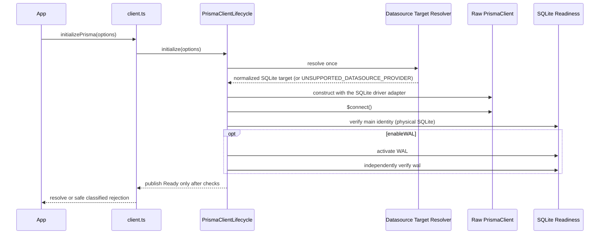
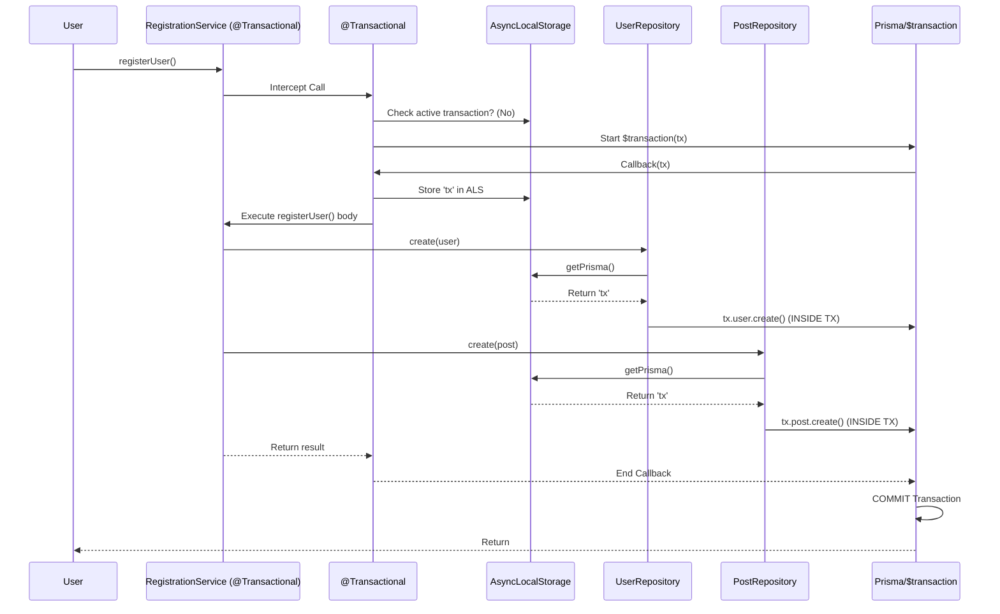

# Design Document: Implicit Repository Pattern & Transaction Management for Prisma (Node.js)

## 1. Overall Pattern

**Goal**: To replicate the "Developer Experience" of the Python `repository_sqlalchemy` library in a Node.js/TypeScript environment using Prisma.
**Core Philosophy**: "Implicit Context over Explicit Parameters". Developers should not need to pass transaction objects (`tx`) manually through their service layers.
**Mechanism**:

- Use Node.js **`AsyncLocalStorage`** (ALS) to store the active Prisma Transaction Client.
- Use **Decorators** (`@Transactional`) to manage transaction barriers and lifecycle.
- Use a **Base Repository** or **Dynamic Getter** pattern to ensure all database queries automatically hook into the active ALS context.
  - The HOF `runInTransaction` reuses the existing ALS client if one is already active to avoid accidental nested transactions.
  - The HOF accepts optional Prisma interactive-transaction settings only at the outer
    transaction boundary. Prisma remains responsible for enforcing them.
  - The exported `prisma` proxy always routes to the correct client (transaction or root), so ad‑hoc queries stay safe.

## 2. File Responsibilities & Architecture

The library has two cooperating authorities: `AsyncLocalStorage` owns the active transaction client,
and `PrismaClientLifecycle` owns the one raw non-transaction root client. Callers above these
boundaries use the exported forwarding surfaces rather than combining a facade with lifecycle
internals.

### A. `src/lib/context.ts` (The State Manager)

**Responsibility**: Managing the lifecycle of the `AsyncLocalStorage`.

- **Key Components**:
  - `prismaContext`: An instance of `AsyncLocalStorage<Prisma.TransactionClient>`.
  - `runInTransactionContext(txClient, callback)`: An internal helper to run a
    function within the scope of a specific transaction client.
  - `runInTransaction(callback, options?)`: The public HOF. It passes an explicitly
    supplied `RunInTransactionOptions` object unchanged to Prisma when opening the
    outer interactive transaction. Omitting options preserves Prisma's one-argument
    call and defaults.
  - `getTransactionClient()`: Returns the current transaction client from store, or `undefined` if none exists.

`RunInTransactionOptions` contains only `maxWait`, `timeout`, and
`isolationLevel`. Prisma owns wait behavior, timers, isolation enforcement, commit,
and rollback. When a transaction is already active, nested HOF calls reuse its ALS
client and ignore inner options; the outer boundary owns configuration and atomicity.

### B. `src/lib/prisma-manager.ts` (The Client Provider)

**Responsibility**: The gateway for obtaining the _correct_ Prisma Client.

- **Key Components**:
  - `getPrismaClient()`: The accessor used by repositories.
    - **Logic**:
      1. Check `context.getTransactionClient()`.
      2. If exists -> Return it (We are inside a `@Transactional` block).
      3. If null -> Return the lifecycle-backed `rootPrismaClient` forwarding boundary.

### C. `src/lib/decorators.ts` (The API Surface)

**Responsibility**: Providing the `@Transactional()` decorator for service methods.

- **Key Components**:
  - `Transactional()`: Method decorator.
    - **Logic**:
      1. Intercept the method call.
      2. Check if we are already in a transaction. If yes, just run the method (Nested Support).
      3. If no, start `prisma.$transaction(async (tx) => { ... })`.
      4. Inside the transaction callback, use `context.runInTransaction(tx, originMethod)`.

### D. `src/lib/base-repository.ts` (The Abstraction)

**Responsibility**: Providing standard CRUD operations that are context-aware and strongly typed via Prisma Generics.

- **Key Components**:
  - `abstract class BaseRepository<M extends Prisma.ModelName>`
  - `protected get delegate()`: Internal context-aware getter.
  - **Public Methods**:
    - `create(args)`
    - `findUnique(args)`
    - `findMany(args)`
    - `update(args)`
    - `delete(args)`

### E. `src/lib/client.ts` and `src/lib/client/lifecycle.ts` (Root Lifecycle)

**Responsibility**: `client.ts` is the thin public facade; `PrismaClientLifecycle` is the sole raw
root-client and lifecycle owner.

- Resolve one explicit datasource target and build the root client with Prisma 7's SQLite driver
  adapter: `PrismaClient({ adapter: createSqliteDriverAdapter(target), log })`. Prisma 7 no longer
  accepts a datasource URL in the client constructor. `PrismaClient` comes from the Prisma client
  module of the lifecycle's client source (below), read when the client is built.
- Own the client source and its registration rule. `registerPrismaClient(module)` reaches
  `registerClientModule`: a malformed argument is a `TypeError`; the module already registered
  (same `PrismaClient` and `Prisma`) is a no-op; a different module is accepted in `Idle` and
  `Failed` and rejected with `PRISMA_CLIENT_CONFLICT` while a client is bound, binding or shutting
  down, like the datasource and logging-policy conflicts. `getClientModule()` is the one read of
  the source, used by `Models` through the facade.
- A client module that cannot be loaded keeps its code `PRISMA_CLIENT_UNAVAILABLE` through both
  entry forms: explicit initialization rejects (raw cause to `onDiagnostic`), and the first lazy
  use throws; as for any construction failure the lifecycle is then `Failed`, so later lazy use
  throws `CLIENT_NOT_READY` until `initializePrisma()` or `shutdownPrisma()`.
- Construct and disconnect the raw root client only inside the lifecycle owner.
- Resolve query logging at construction through `src/lib/client/logging-policy.ts`.
  The default levels are `info`, `warn`, and `error`; `query` is appended only when
  `PRISMA_LOG_QUERIES` is explicitly truthy or `initializePrisma({ logQueries: true })`
  is supplied. The typed option takes precedence over the environment flag.
- Capture the effective logging policy in every lifecycle state carrying the raw root
  client. A differing later typed policy rejects with `LOGGING_POLICY_CONFLICT` until
  `shutdownPrisma()` establishes a new binding boundary.
- Track lifecycle state as one discriminated union: `Idle`, `LazyBound`, `Initializing`, `Ready`,
  `Failed`, or `ShuttingDown`.
- Keep a candidate private until connection and required SQLite checks pass.
- Reject access during initialization, failure, or shutdown with `CLIENT_NOT_READY`.
- Share an identical in-flight initialization request; reject different target/readiness requests.
- Clear target, client, readiness, failure, and in-flight authority after shutdown even if disconnect
  itself fails.

The related internal files remain subordinate to this owner:

- `client/client-source.ts` (`PrismaClientSource`) owns where the Prisma client module comes
  from, as explicit state: `default-package` from the start, or `registered` with the module the
  application passed. `current()` switches on that state: a registered module is returned as is;
  the default package, `@prisma/client` (prisma-client-js output), is required on first need and
  any load failure is classified `PRISMA_CLIENT_UNAVAILABLE` with the raw cause. It also owns the
  module shape check. It knows no lifecycle state. Only the lifecycle constructs and holds it
  (tests may inject one), and it is the only runtime loader of `@prisma/client`.
- `client/datasource-target.ts` selects, classifies, and normalizes the target. Physical SQLite
  relative paths are `process.cwd()`-relative. It owns the supported-provider rule: the library
  supports SQLite only, so any other URL is rejected here with `UNSUPPORTED_DATASOURCE_PROVIDER`,
  before a client exists. Explicit initialization and lazy binding share this one check, so both
  report the same code. Resolution runs before the conflict, logging-policy and WAL checks, so the
  code applies in every lifecycle state except shutdown (`CLIENT_NOT_READY`), and a bound client is
  left untouched.
- `client/sqlite-driver-adapter.ts` owns how the library opens SQLite under Prisma 7. A file target
  opens its resolved physical path; the URL query string stays only in the target's binding key,
  because the adapter would treat it as part of the file name. A memory target opens `:memory:`.
  `timestampFormat: 'unixepoch-ms'` keeps `DateTime` values as INTEGER unix milliseconds, the
  representation Prisma 5 used. The adapter's default (ISO-8601 text) would make range filters
  and ordering miss rows written by Prisma 5, so existing databases stay directly usable without a
  migration. The adapter does not know lifecycle state. It wraps the adapter in the
  connection gate.
- `client/sqlite-connection-gate.ts` keeps transactions isolated on the adapter's single
  connection. The better-sqlite3 adapter runs every operation of a client on one connection,
  and only its transactions take the adapter's own lock. Without the gate, a plain query from
  another request would run inside an open transaction: it would see uncommitted rows, and its
  writes would be rolled back with that transaction. Prisma 5's engine pool gave such a query its
  own connection. The gate gives the connection one FIFO lock. A plain `queryRaw`, `executeRaw`
  or `executeScript` holds it for its call. `startTransaction` takes it, and the transaction
  releases it exactly once on commit or rollback (even if that fails), or at once if starting
  fails. Statements of the transaction run under the lock it already holds. The gate has no
  timeout of its own, and knows no ALS, lifecycle state, target or SQL; Prisma's `maxWait` and
  `timeout` bound waiting through the transaction. Gating at the adapter, the narrowest layer
  that sees every database access, also covers Prisma-internal transactions (nested writes) and
  batch `$transaction([...])`. Prisma's own libsql adapter applies the same rule.
  Consequences: plain operations wait while a transaction is open, and transactions run one at a
  time; a queued transaction fails with Prisma's `P2028` after its `maxWait`. A `rootPrismaClient`
  call inside a transaction callback waits for that transaction, which then times out.
- `client/sqlite-readiness.ts` owns `PRAGMA database_list`, WAL activation, and the independent
  journal-mode verification. It cannot publish or disconnect a client.
- `client/initialization-error.ts` owns safe stable codes/messages and guarded opt-in diagnostics. It
  does not log raw causes.

The package facade and Prisma CLI configuration do not import `dotenv/config` or load
`.env` files. Applications, scripts, and CI own environment provisioning; the library
reads already-present values only when resolving a datasource or constructing a client.
The Prisma CLI reads its URL from `prisma.config.ts`; the schema datasource has no `url`
(Prisma 7). Prisma 7 also no longer generates the client on install, so the package's `prepare`
script runs `prisma generate` after `npm install`/`npm ci`.

### Package ESM/CommonJS Boundary

The package exports separate ESM and CommonJS artifacts through the existing `exports.import`
and `exports.require` conditions. Both Prisma peers, `@prisma/client` and `@prisma/adapter-better-sqlite3`, are external (tsup
`external`) and supplied by the consumer, which keeps the adapter in version lockstep with the
client and leaves the native better-sqlite3 build to the consumer's platform. The adapter is a real
ESM package, so the lifecycle imports `PrismaBetterSqlite3` by name; its native module loads only
when a database is opened, never at package import.

The package imports no Prisma client module at load time. Prisma 7's `prisma-client` generator
writes the client into the application, and `@prisma/client`'s root entry then fails to load
(it needs prisma-client-js output), so a static import would make the package unimportable for
those applications. The client source loads `@prisma/client` only when the default package is
first needed, with `createRequire(import.meta.url)('@prisma/client')`. That is a CommonJS require
in both builds, so it never depends on Node's named-export detection for the CommonJS peer, and
Node's module cache makes repeated loads free. The build targets es2020 so the ESM output keeps
`import.meta`; tsup's `shims` supply `import.meta.url` in the CommonJS output. The source
typecheck uses `module: esnext` with `moduleResolution: bundler`, which allows `import.meta`.
Bundlers do not trace a `createRequire` call, so an application that bundles the library and
relies on the default package must keep `@prisma/client` external (registered clients are
unaffected). This replaces the earlier rule that the package adds no `createRequire` path.

Prisma types come only from `src/lib/prisma-types.ts` (below), through `import type`, so
declarations add no runtime peer edges. Package validation includes a synthetic dynamic
CommonJS-peer ESM probe, the installed generated-peer smoke, and a consumer on the
`prisma-client` generator without prisma-client-js output.

### F. `src/lib/prisma-types.ts` and `src/lib/models.ts` (Client Types and Model Names)

**Responsibility**: the public types follow the same client as the runtime.

- `prisma-types.ts` owns the type registry `PrismaClientRegistry` and every type derived from
  it: the client (`RegisteredPrismaClient`), `ModelName`, the `Models` object type, the
  transaction client, the interactive-transaction isolation level and the filter type of
  `buildContainsFilter`. An application on the `prisma-client` generator declares its generated
  module once (`interface PrismaClientRegistry { client: typeof generated }`); without a
  declaration every type is exactly the `@prisma/client` type, as in 2.0.0. Public values are
  annotated with these aliases (`prisma`, `rootPrismaClient`) so the declaration bundler keeps
  the alias instead of inlining the default client type.
- The registration and the declaration cannot disagree. `registerPrismaClient`'s parameter is
  `RegisteredClientModule`: exactly the declared module, or, with no declaration (or one that is
  not a generated module), `MissingTypeDeclaration`, an object type whose one property name is
  the declaration to add, so the call fails to compile with the fix in the message. It references
  no `@prisma/client` type: without prisma-client-js output those types are `any`, so a check
  built on them could never fail. The runtime shape check stays in the lifecycle
  (`registerClientModule(value: unknown)`) for JavaScript callers and casts; the runtime shape
  `PrismaClientModule` is internal and not exported.
- A `PrismaClientRegistry` augmentation applies to its whole TypeScript program, so the repository
  type-checks two programs: `tsconfig.json` (no declaration; it holds the prisma-client-js
  type-equality cases) and `tsconfig.prisma-client-generator.json` (the registered example and
  tests, with `repository_prisma` path-mapped to `src/index.ts`, its own `exclude`, and the
  generated client in `generated/prisma-client/`). `scripts/check-typecheck-programs.js` checks
  which files each program compiles (DC-002).
- `Models` is a read-only view of the current client module's `Prisma.ModelName`, read on every
  access through the facade (`getPrismaClientModule()`, not exported by the package) and the
  lifecycle. It follows a later registration and loads nothing at import. It forwards `get`,
  `has`, `ownKeys` and property descriptors (reported configurable, because the proxy target does
  not own the keys), so `Object.keys`, `in` and spread work; writes are rejected. A missing client
  throws `PrismaInitializationError` with `PRISMA_CLIENT_UNAVAILABLE`. Because `Models` resolves on
  access, a module that reads `Models.X` at load time must be evaluated after the registration.

### G. `src/lib/forwarding-proxy.ts` and `src/lib/prisma-proxy.ts` (Access Routing)

**Responsibility**: Preserve Prisma-shaped public access without leaking a retained raw root or ALS
delegate.

Property inspection may resolve the current surface, but returned model-delegate and method handles
are forwarding wrappers. When called, a wrapper resolves the current root/transaction owner again and
uses `Reflect.apply` with that owner as `this`. The proxy is explicitly non-thenable. Root `$connect`
and `$disconnect` route to lifecycle initialization and shutdown.

Prisma APIs that return caller-owned client-like surfaces (for example `$extends`) and already-invoked
Prisma promises are outside revocation scope; the lifecycle guarantee applies to the exported
forwarding boundaries and pre-invocation handles captured from them.

---

## 3. Execution Flows

### Root Initialization and SQLite Readiness



`enableWAL: true` is fail-closed. A connection, identity, activation, or verification failure
disconnects the candidate, moves the lifecycle to `Failed`, invokes only explicitly registered
diagnostic callbacks with the raw cause, and rejects with a safe `PrismaInitializationError`.

### Transaction Routing

**Scenario**: A `RegistrationService` creates a `User` and a `WelcomePost` atomically.



## Design Cases

Each case records a design mistake found in this project and what it taught: the problem, how it
was found, the assumption that was wrong, the fix, and the lesson. Read the cases before designing
or reviewing a change of the same shape. New cases are appended with the next `DC-` number.

### DC-001: Single SQLite connection and transaction isolation (Prisma 7 upgrade, CR-001)

- **Problem:** On Prisma 7, the better-sqlite3 driver adapter runs every operation of a client on
  one connection, and only its transactions take the adapter's own lock. A query from another
  request, outside any transaction, ran inside an open transaction: it read uncommitted rows, and
  its write was rolled back with that transaction. Prisma 5's engine pool had given it its own
  connection.
- **How it was found:** code review reproduced it with two concurrent requests through the public
  API (one inside `runInTransaction`, one without a transaction), and compared the result with
  the released 1.0.10.
- **Wrong assumption:** the first design treated the single connection as a throughput concern
  outside the library's contract, based on tests that ran requests one after another.
- **Fix:** the connection gate (`src/lib/client/sqlite-connection-gate.ts`, section E above), one
  lock per connection that a transaction holds until it ends.
- **Lesson:** trace each entry form of a mechanism (concurrent as well as sequential requests)
  through the real dependency before declaring a risk outside the contract.

### DC-002: A type check that compiled none of the files it was meant to check (prisma-client generator, ARCH-REV-003 AR-003)

- **Problem:** the design added a second typecheck program for the registered example and tests,
  `tsconfig.prisma-client-generator.json`, extending `tsconfig.json` and overriding only `include`.
  TypeScript inherits `include` and `exclude` separately, so the child kept the base `exclude`,
  which named exactly the registered folders. The program compiled none of them, and `tsc` passed.
- **How it was found:** architecture review reproduced it with `tsc --listFilesOnly` and a
  deliberately broken file in the excluded folder; `tsc` still exited 0.
- **Wrong assumption:** the design's feasibility probe read "no errors" as "the files compile",
  without checking which files were in the program.
- **Fix:** the registered config sets its own `exclude`, and `npm run typecheck` runs
  `scripts/check-typecheck-programs.js`, which fails unless each registered file is in the
  registered program and absent from the default one.
- **Lesson:** a passing check proves nothing about inputs it never saw. Before relying on a
  passing type check or test run, confirm the files are in it (`--listFilesOnly`, the test list)
  and run one negative control that must fail.

## 5. FAQ / Architectural Decisions

### Q: Can I define models as TypeScript Classes (Code-First)?

**No, this is a fundamental difference in Prisma.**

- **SQLAlchemy / TypeORM (Code-First)**: You define a class `User` in code, and the ORM generates the table from it.
- **Prisma (Schema-First)**: You define the table in `schema.prisma`, and the ORM generates the TypeScript types/interfaces from it.
- **Why?**: Prisma creates a "Single Source of Truth" that is independent of your programming language. This allows for better performance (Prisma generates its query code from the schema) and perfect type safety without runtime reflection overhead.

### Q: Do I need `@Transactional` for every method?

**NO.**

- **Single Operations**: Just call `this.userRepo.create(...)`. It is automatically atomic (standard Prisma behavior). You do **not** need the decorator.
- **Multiple Operations**: Use `@Transactional` **only** when you need to group multiple repository calls into a single Unit of Work (so they commit/rollback together).
This matches the Python `repository-sqlalchemy` design: "Implicitly atomic by default, explicitly transactional when needed."

### Q: Do I need to initialize Prisma explicitly?

**Only if you want eager connection, verified SQLite identity, or strict SQLite WAL readiness.**

- By default, Prisma connects lazily on first query.
- If you want startup proof, call `initializePrisma(...)` and await it before serving traffic.
- A non-empty `datasourceUrl` is authoritative. Otherwise the documented environment precedence is
  resolved once, and the library opens that SQLite target itself.
- `enableWAL: true` supports only physical SQLite and resolves only after WAL is verified.
- Switching a bound target requires `await shutdownPrisma()` first.

### Q: How does `@Transactional` work in Node.js?

In TypeScript, when you enable `experimentalDecorators`, the `@Transactional` annotation is compiled into a **Higher-Order Function** that wraps your original method.

- **Runtime**: It receives the method descriptor. We replace `descriptor.value` with a new function that:
  1. Checks if a transaction is already active.
  2. If not, creates a new one via `prisma.$transaction`.
  3. Runs the original method inside that scope.
- **Support**: While technically "experimental" in TypeScript, this pattern is the **standard** in major frameworks like **NestJS**, **TypeORM**, and **Angular**. It is robust and production-ready for TypeScript projects.

### Q: Why not use `.delegate` directly?

We want to mimic the clean API of the Python implementation. Exposing `this.repository.delegate.create` is "leaky" (it exposes the raw Prisma client) and verbose.
Instead, `BaseRepository` will strictly implement standard CRUD methods (`create`, `findById`, etc.), internally managing the context-aware delegate. This provides a cleaner, stricter "Repository Pattern" abstraction.

---

## 4. Usage Example

Here is how the end-user (developer) uses this library. Note the clean separation of business logic and infrastructure.

### The Setup (Repository Layer)

```typescript
// user.repository.ts
import { BaseRepository, Models } from "repository_prisma";

// STRICT TYPING: No string literal needed.
export class UserRepository extends BaseRepository.forModel(Models.User) {
  // Model name mapped from Models.User -> "user"
}
```

### The Business Logic (Service Layer)

```typescript
// registration.service.ts
import { Transactional } from "./lib/decorators";
import { UserRepository } from "./user.repository";
import { PostRepository } from "./post.repository";

export class RegistrationService {
  private userRepo = new UserRepository();
  private postRepo = new PostRepository();

  // MAGIC HAPPENS HERE: The decorator handles the transaction connection
  @Transactional()
  async registerUser(email: string, initialPost: string) {
    // 1. Create User
    // CLEAN API: Standard CRUD methods
    const user = await this.userRepo.create({ data: { email } });

    // 2. Create Post
    // Automatically joins the SAME transaction
    await this.postRepo.create({
      data: {
        title: initialPost,
        authorId: user.id,
      },
    });

    // If anything fails here, BOTH operations rollback.
    return user;
  }
}
```
